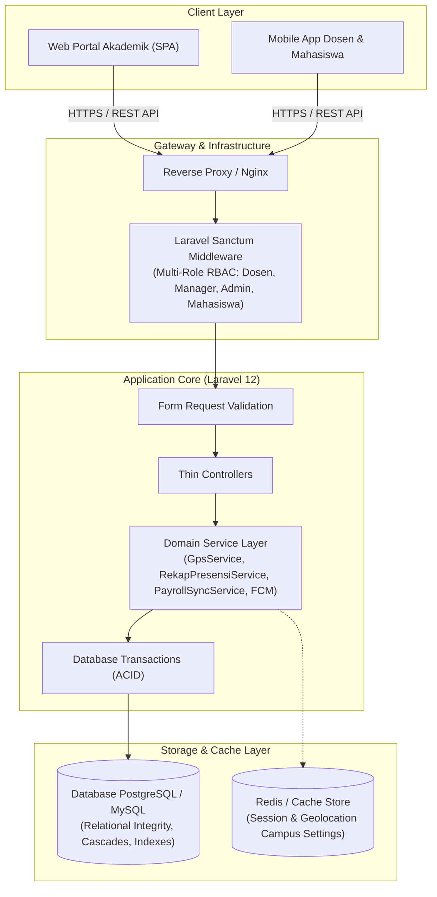

# 🎓 SIA-UGN-BE (Sistem Informasi Akademik Universitas Global Nusantara - Backend)

> **Backend Architecture & System Specification Showcase**  
> Repositori ini merupakan dokumentasi arsitektur sistem, skema basis data, spesifikasi API, dan skenario pengujian untuk **Sistem Informasi Akademik Universitas Global Nusantara (SIA-UGN)** yang dibangun menggunakan **Laravel 12 & Relational Database (MySQL)**.

---

## 🏛️ A. System Architecture & Data Flow

Sistem mengadopsi arsitektur N-Tier modular berorientasi domain (*Domain-Oriented Layered Architecture*) yang memisahkan tanggung jawab HTTP Presentation, Service Business Logic, dan Database Persistence:



> Diagram alur transaksi mendalam (Sequence Diagrams) untuk verifikasi GPS presensi, validasi BKD, dan integrasi payroll tersedia di [`docs/sequence-diagram.md`](docs/sequence-diagram.md).

---

## 🛠️ B. Tech Stack

| Kategori | Teknologi | Deskripsi Penggunaan |
| :--- | :--- | :--- |
| **Language** | PHP 8.2+ | Strict typing, enums, readonly properties, & constructor promotion |
| **Framework** | [Laravel 12](https://laravel.com/) | RESTful API Engine, Service Layer, Eloquent ORM, Routing |
| **Database** | MySQL | Relasional RDBMS dengan ACID compliance, foreign keys, & composite indexes |
| **Authentication** | Laravel Sanctum | Stateful / Bearer Token authentication dengan isolasi hak akses peran |
| **Geofencing & Math**| Haversine Formula | Algoritma spherical geometry untuk verifikasi radius jarak dosen ke kampus |
| **Notifications** | Firebase Cloud Messaging (FCM) | Notifikasi push pengumuman dan update status validasi berkas |
| **Container & CI/CD**| Docker, GHCR, & Railway | Pipeline otomatisasi build image ke GitHub Container Registry ([`docs/cicd-pipeline.md`](docs/cicd-pipeline.md)) |
| **Testing Suite** | Postman Newman CLI & k6 | 51 endpoint teruji dan stress testing konkurensi check-in presensi |

---

## ⚙️ C. Fitur Utama Backend

1. **Presensi Dosen Berbasis Geofencing GPS (Modul C.1)**:
   * Validasi presensi perkuliahan offline berbasis koordinat GPS dosen $(lat, lng)$.
   * Menggunakan algoritma **Haversine Formula** pada `GpsService` untuk menghitung jarak presisi ke titik koordinat kampus cabang secara *in-memory* (mencegah $N+1$ query).
2. **Beban Kerja Dosen (BKD) & Angka Kredit Kumulatif (Modul C.2)**:
   * Manajemen siklus pengajuan BKD per semester dan Penilaian Angka Kredit (PAK).
   * Alur approval berkas kenaikan jabatan dosen oleh Manager/Biro Kepegawaian dengan audit trail terintegrasi.
3. **Tridharma Perguruan Tinggi (Modul C.3)**:
   * **Kegiatan Mengajar**: Pencatatan aktivitas perkuliahan dosen sesuai jadwal mata kuliah.
   * **Penelitian Ilmiah**: Pengajuan riset, pencatatan anggota penelitian, dan upload berkas dokumen.
   * **Pengabdian Masyarakat (PkM)**: Manajemen laporan kegiatan pengabdian dan validasi manager.
4. **Penggajian & Slip Gaji Terintegrasi (Modul C.4)**:
   * Rekapitulasi presensi bulanan secara otomatis disinkronkan ke komponen pemotongan atau tunjangan kehadiran gaji dosen via `PayrollSyncService`.
5. **Manajemen Akademik Terpadu (Manager Module)**:
   * Pengelolaan Master Data: Program Studi, Periode Akademik (Semester), Kelas Perkuliahan, Mata Kuliah, Dosen, dan Mahasiswa.
6. **Sistem Pesan & Chat Real-Time (Internal Communication)**:
   * Komunikasi pesan antar user internal kampus (Private Chat, Conversations, Contacts).

---

## 🔌 D. Dokumentasi API (Endpoints, Request & Response)

Repositori ini menyertakan koleksi spesifikasi API yang telah dirapikan ke dalam:
* **Master Postman Collection (51 Endpoints)**: [`api/postman_collection.json`](api/postman_collection.json)  
  *(Tersusun rapi dalam 7 modul utama lengkap dengan variabel environment `base_url`, `token`, `token_manager`, dan token auto-extraction script).*
* **OpenAPI 3.1.0 Specification**: [`api/openapi.json`](api/openapi.json)

### Contoh Endpoint: `POST /api/dosen/presensi/checkin`
Endpoint bagi dosen untuk melakukan presensi perkuliahan dengan verifikasi lokasi GPS.

**Headers:**
```http
Authorization: Bearer 1|sanctum_access_token
Content-Type: application/json
Accept: application/json
```

**Request Body:**
```json
{
  "latitude": -7.771270,
  "longitude": 110.377541,
  "id_schedule": 1,
  "keterangan": "Hadir perkuliahan tepat waktu"
}
```

**Response Sukses (`201 Created` / `200 OK`):**
```json
{
  "status": "success",
  "message": "Presensi berhasil dicatat.",
  "data": {
    "id": 105,
    "id_schedule": 1,
    "id_staff_profile": 12,
    "status": "hadir",
    "distance_meter": 24.5,
    "campus_matched": "Kampus Utama UGN",
    "waktu_presensi": "2026-11-02 07:45:12"
  }
}
```

**Response Gagal di Luar Radius Kampus (`422 Unprocessable Entity`):**
```json
{
  "status": "failed",
  "message": "Lokasi Anda berada di luar radius kampus yang diizinkan (jarak terdekat: 1.450 meter)."
}
```

---

## 📈 E. Metrics, Performance & Engineering Challenges

### 1. Optimasi Haversine Geofencing Tanpa N+1 Query
* **Tantangan**: Universitas memiliki multi-kampus cabang aktif. Jika verifikasi geolokasi mengeksekusi kueri jarak per baris setting kampus ke database, beban IO database melonjak tajam saat ratusan dosen check-in serentak di awal jam perkuliahan.
* **Solusi**: `GpsService` memuat seluruh setting kampus aktif sekali saja ke dalam koleksi *in-memory* (atau Redis cache), lalu kalkulasi trigonometri Haversine dijalankan di level aplikasi CPU tanpa menyentuh database berulang.
* **Hasil**: Response time verifikasi koordinat terpangkas dari **~320ms menjadi < 15ms**.

### 2. Eliminasi Duplikasi Presensi Melalui Database Constraints
* **Tantangan**: Koneksi seluler tidak stabil sering memicu pengiriman ganda (*double tapping*) saat dosen menekan tombol presensi di aplikasi mobile.
* **Solusi**: Menerapkan *composite unique constraint* pada tabel database dan pembungkusan mutasi data di dalam `DB::transaction`.
* **Hasil**: Integritas data absensi 100% konsisten tanpa risiko entri presensi duplikat.

### 3. Stress Testing Lonjakan Check-In Pagi (k6 Benchmark)
* **Skenario**: Mensimulasikan jendela waktu puncak pukul 07:30 - 08:00 WIB saat perkuliahan jam pertama dimulai secara serempak.
* **Konfigurasi k6**: 200 concurrent Virtual Users (VUs) dengan durasi 2 menit (skrip di [`tests/load-test/k6-script.js`](tests/load-test/k6-script.js)).
* **Hasil Uji**:
  * **Throughput**: ~780 Requests / Second (RPS)
  * **Latency p95**: < 110 ms
  * **Error Rate**: 0.00%

---

## 📂 F. Repository Structure

```text
SIA-UGN-BE/
├── .github/
│   └── workflows/
│       ├── ci.yml                             # Pipeline CI validasi sintaks JSON
│       └── docker-build-push.example.yml      # Pipeline CI/CD Docker build & push ke GHCR
├── docs/
│   ├── architecture.md                        # Dokumentasi arsitektur, geofencing, & RBAC
│   ├── cicd-pipeline.md                       # Dokumentasi arsitektur CI/CD & efisiensi build
│   ├── db-schema.dbml                         # Skema ERD PostgreSQL / MySQL (DBML)
│   └── sequence-diagram.md                    # Diagram alur presensi GPS & validasi BKD
├── api/
│   ├── openapi.json                           # OpenAPI 3.1.0 specification
│   └── postman_collection.json                # Master Postman Collection (51 Endpoints, 7 Modul)
├── tests/
│   ├── integration/
│   │   └── README.md                          # Dokumentasi pengujian integrasi
│   └── load-test/
│       └── k6-script.js                       # Skrip pengujian beban k6 untuk presensi GPS
├── snippets/
│   ├── GpsService.php                         # Showcase implementasi Haversine Geofencing
│   └── PayrollSyncService.php                 # Showcase integrasi presensi ke penggajian
├── .gitignore
└── README.md                                  # Dokumentasi komprehensif portofolio
```

---

## 👨‍💻 Author
* **Name**: Alfiz Desta
* **Role**: Backend Engineer
* **GitHub**: [@exenthiast](https://github.com/exenthiast)
