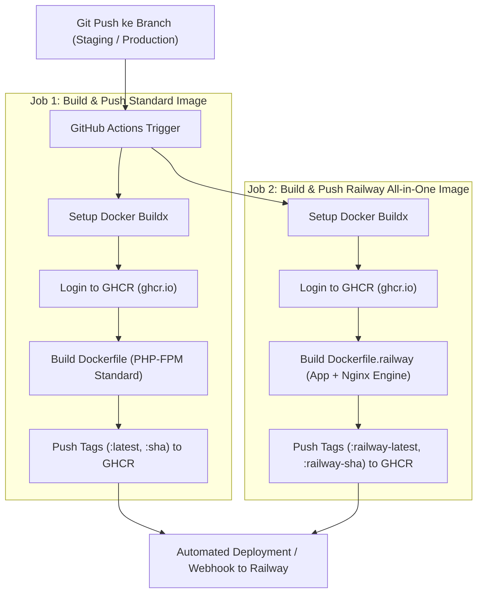

# 🚀 CI/CD Pipeline & Containerization Architecture

Dokumentasi pipeline otomatisasi *Continuous Integration & Continuous Deployment* (CI/CD) untuk build container Docker dan publish ke **GitHub Container Registry (GHCR)** serta deployment ke **Railway Cloud**.

---

## 🏛️ Pipeline Flowchart

---

## 🛠️ Highlights Pipeline & Efisiensi Build

1. **Docker Buildx & GitHub Actions Cache (`type=gha`)**:
   * Memanfaatkan cache layer GitHub Actions (`mode=max`) agar proses dependency download (Composer & Npm) tidak berulang setiap build.
   * Mengurangi durasi build image dari **~6 menit menjadi < 1.5 menit**.
2. **Dual Target Image Architecture**:
   * **Standard Image (`Dockerfile`)**: Digunakan untuk arsitektur terpisah (PHP-FPM container + Nginx reverse proxy terpisah).
   * **Railway All-in-One Image (`Dockerfile.railway`)**: Digunakan untuk deployment PaaS mandiri di mana Nginx dan PHP-FPM berjalan bersamaan di container yang sama.
3. **Automated Version Tagging**:
   * Tag `:latest` otomatis terpasang saat push ke default branch.
   * Tag commit hash (`:sha`) dan `:railway-{sha}` memudahkan *rollback* versi aplikasi secara instan jika terjadi insiden di production.

---

## 📄 File Konfigurasi Workflow
Workflow lengkap tersimpan di:
👉 [`.github/workflows/docker-build-push.example.yml`](../.github/workflows/docker-build-push.example.yml)
