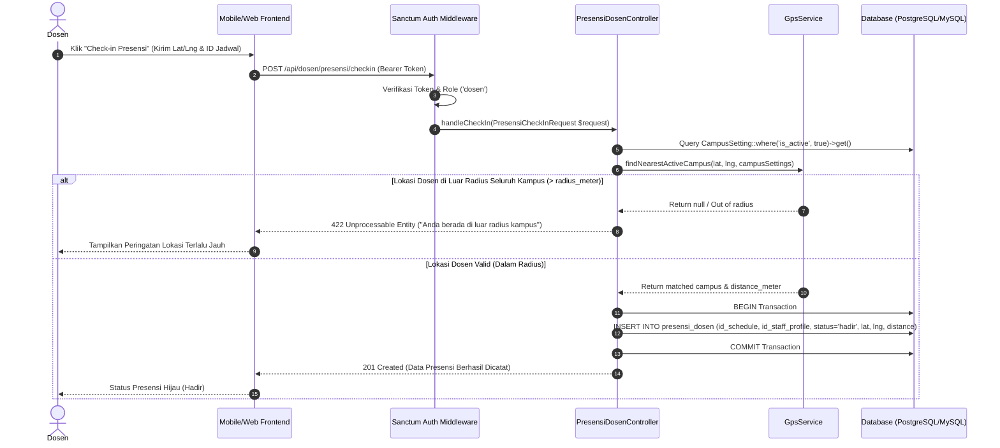
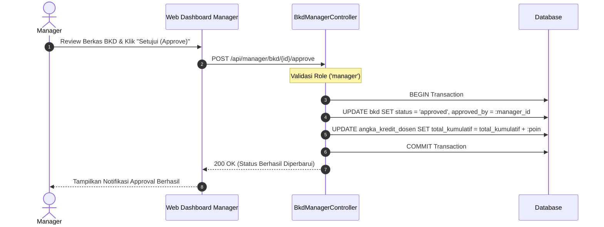
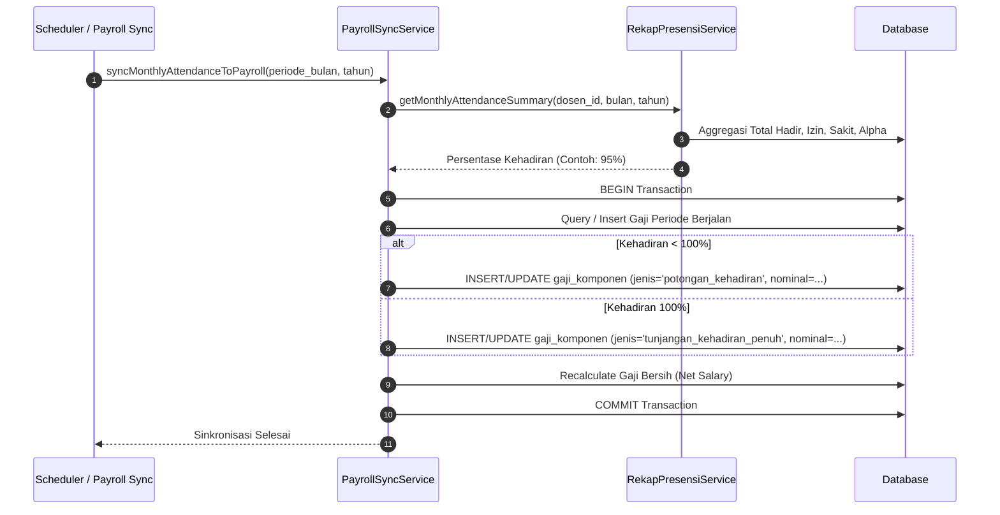

# 🔄 Sequence Diagrams

Dokumentasi alur proses kritis pada sistem backend SIA-UGN (Laravel 12 & RDBMS).

---

## 1. Alur Presensi Dosen Berbasis Geofencing GPS (Haversine Formula)

Menjelaskan alur saat Dosen melakukan check-in perkuliahan melalui mobile/web dengan validasi radius lokasi kampus.

---

## 2. Alur Validasi BKD / Kenaikan Jabatan oleh Manager

Menjelaskan alur verifikasi berkas Beban Kerja Dosen dan pembaharuan Angka Kredit Kumulatif (PAK).

---

## 3. Alur Integrasi Rekap Kehadiran Presensi ke Penggajian (C.1 $\rightarrow$ C.4)

Menjelaskan sinkronisasi otomatis persentase kehadiran dosen ke dalam komponen pemotongan atau tunjangan kehadiran gaji bulanan.

